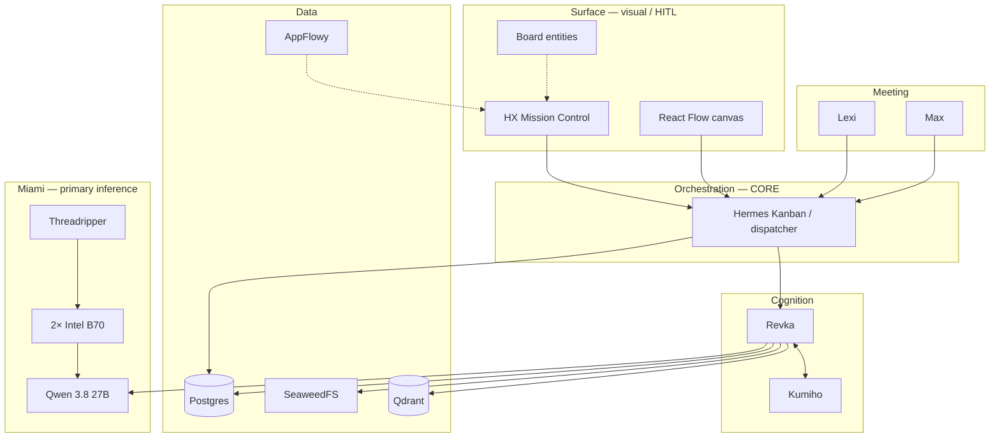

# Smart VidiFlow — Master Plan

> **SUPERSEDED — dated snapshot (2026-09-17).** This file is preserved as the historical 09-17 lock.
> **Current canonical:** `VIDIFLOW-MASTER-PLAN.md` (updated 2026-09-22), which adds the SmartGen
> content engine (SmartChannel CX :3030, VidiShop/VidiMail/VidiBlast), the local media stack
> (Qwen-Image-2.1 RGBA; MiniMax H3 / LTX / Wan video), the personalization model, vLLM XPU as the
> production serving path, and the Qwen-Image-2.1 + MiniMax H3 **licence gates**. Do not source
> architecture decisions from this snapshot.

**Canonical as of 2026-09-17.** Supersedes the August 20, 2026 Smart VidiFlow Master Plan for architecture locks. Phase status from Aug is retained where still accurate; compute and orchestration layers are brought forward.

**Companion lock:** `VIDIFLOW-SMART-FLOW-LOCK-2026-09-17.md`  
**Business pack:** `VIDIFLOW-VIDISMART-BUSINESS-PLAN.md`  
**Revka/Kumiho detail:** `REVKA-KUMIHO-CONTEXT-LOCK.md`

---

## Goal

Build **Smart VidiFlow**: the visual, glance-level control panel for the entire AI agent fleet — agents seen through color, position, and shape, not text — with voice so the operator can talk to any agent and it talks back in real time.

Product surface names: **VidiFlow HX** (visual agentic OS / Mission Control) + **Smart Meeting / Smart App**.

---

## Architecture lock (layered — do not merge)

| Layer | System | Role |
|---|---|---|
| **Surface** | HX Mission Control + React Flow canvas (+ Peerdom/Rolebase–Maptio DNA) | Visual / HITL only — **not** the task orchestrator. Agents may appear as board entities. |
| **Orchestration** | **Hermes Agent Kanban / dispatcher** | **CORE task orchestration** (supersedes Sep 7 “Hermes = entities only”) |
| **Cognition** | **Revka** + **Kumiho** | Revka = governed agent runtime; Kumiho = graph memory; turn shape **engage → context → answer → reflect** |
| **Meeting** | Lexi + Max | Smart Meeting personas; spine still open (see Open questions) |
| **Data** | Postgres + **SeaweedFS** + AppFlowy + Qdrant | Object store = **SeaweedFS** (not MinIO). AppFlowy = SOPs / docs / plans / PM. Qdrant = vector knowledge. |
| **Miami compute** | Threadripper + **2× Intel Arc Pro B70** + **Qwen 3.8 27B** | First-class primary Miami inference |
| **Cloud (experimental)** | Cloudflare Agent OS (`@cloudflare/computer`) | Alongside local Hermes — does not replace it |

---

## Confirmed decisions

- **Name:** Smart VidiFlow / VidiFlow HX. “VidiMeet” retired.
- **Interface:** visual-first; chat in agent drill-down / meeting surfaces, not as the primary panel.
- **Task orchestration:** Hermes Agent Kanban/dispatcher is **core**. Mission Control + canvas = visual HITL.
- **Agent cognition:** Revka (runtime/governance) + Kumiho (graph memory) required for accurate Smart App answers (2026-09-15 lock).
- **Local model path (dev / workstation):** LM Studio (`http://localhost:1234/v1`), not Ollama. Hermes context floor ≥ 64K where Hermes profiles are used.
- **Miami primary brain:** Qwen 3.8 27B on Threadripper + 2× Intel Arc Pro B70.
- **Voice / meetings (interim):** LiveKit self-hosted + Agents + Piper / Edge TTS still in the stack; Lexi/Max UI in progress. **Arch commit still open:** Tavus CVI vs LiveKit + sovereign STT.
- **Knowledge:** Qdrant + FastEmbed; per-tenant namespaces `kb_{tenant_id}`.
- **Object storage:** **SeaweedFS** S3-compatible (e.g. :9000). Do **not** pull MinIO (closed source).
- **Cloud media:** `cdn.vidi.news` = Cloudflare R2 bucket `vidismart`.
- **Docs / PM:** AppFlowy (not Notion) for SOPs, docs, plans, project management.
- **Cloud agents:** `@cloudflare/computer` experimental track beside local Hermes fleet.
- **Foundation reused:** `M:\code\vidismart\agent-backend` (:3007), agent UI, piper, `.env.tts`.

---

## Implementation status (carried forward from Aug 2026)

### Phase 1 — Hermes + local models — IN PROGRESS
- Hermes installed/verified historically; profiles = one per agent role where Hermes is the worker surface.
- **Bring-forward:** Hermes Kanban/dispatcher is the **orchestration** layer; pair workers with Revka+Kumiho for governed accurate turns.
- LM Studio endpoint (not Ollama) for local OpenAI-compatible inference; Miami B70/Qwen is the production Miami target.

### Phase 2 — Control plane (agent-backend) — MOSTLY DONE
- Fleet registry, telemetry, command dispatch, Socket.IO events.
- Register Hermes (and later cloud) agents through fleet API so Mission Control shows one grid.

### Phase 3 — Visual control panel — DONE (evolve to HX Mission Board)
- agent-ui / HX Mission Control + React Flow canvas path.
- Keep visual/HITL; do not make the canvas the task DB — that is Hermes Kanban.

### Phase 4 — Voice / Smart Meeting — SERVER PARTIAL, AGENTS PENDING
- LiveKit server path exists; Lexi + Max meeting layer started 2026-09-16.
- **Open:** Tavus CVI vs LiveKit face-only + BYO/sovereign STT.

### Phase 5 — Knowledge — DONE (custom pipeline)
- Qdrant + FastEmbed ingest; wire citations into Revka/Kumiho-aware agent prompts.

### Phase 6 — Storage — DONE (SeaweedFS)
- SeaweedFS all-in-one / S3 path. MinIO removed from current plan.

### Phase 7 — Cloudflare Agent OS — EXPERIMENTAL
- Durable Object agents; feature-flagged; local Hermes remains production orchestration path.

### Phase 8 — Revka + Kumiho (NEW / REQUIRED)
- Wire engage → context → answer → reflect into final Smart App.
- Glance UI must render live Kumiho graph state, not mock nodes.
- Detail: `REVKA-KUMIHO-CONTEXT-LOCK.md`.

### Phase 9 — Miami fleet (NEW / LOCKED)
- Stand up / document Threadripper + 2× Intel Arc Pro B70 serving Qwen 3.8 27B.
- Treat as first-class in bandwidth / privacy / demo story (separate from AirPMD dual RTX PRO 6000 lean MVP track).

---

## Compute plan (updated)

### Miami — PRIMARY (locked 2026-09-17)
- **Hardware:** Threadripper + **2× Intel Arc Pro B70**
- **Model:** **Qwen 3.8 27B**
- First-class in smart-flow structure and sovereign demos.

### Workstation / lab — retained
- Local LM Studio brains on available NVIDIA cards (e.g. RTX 4090 path from Aug plan) remain valid for **dev/lab**.
- Planned **2× RTX 6000 Pro** expansion (AirPMD / high-VRAM track) stays a **separate** scale ladder — does not replace Miami B70/Qwen as the Miami lock.

### Cloud inference — optional
- Workers AI / Paid plan models for Cloudflare Agent OS only; not a substitute for Miami sovereign path.

---

## Validation checklist (updated)

- [ ] Hermes Kanban/dispatcher owns task orchestration; Mission Control is visual/HITL only
- [ ] Revka + Kumiho engage→reflect green on Smart App agents
- [ ] SeaweedFS serving media/object buckets (no MinIO)
- [ ] Miami Threadripper + 2× B70 serving Qwen 3.8 27B end-to-end
- [ ] Fleet dashboard shows real Hermes (+ optional cloud) agents
- [ ] Lexi/Max meeting path works for voice (arch TBD)
- [ ] Document ingest → Qdrant searchable with tenant isolation
- [ ] AppFlowy holds SOPs/plans as team knowledge base

---

## Risks

- **Layer collapse** — merging Hermes, Mission Control, and Revka into one blob. Keep layers separate.
- **Ollama drift** — LM Studio (or Miami OpenAI-compatible endpoint) is the local path; do not reintroduce Ollama as default.
- **MinIO reintroduction** — closed source; SeaweedFS is the lock.
- **64K context floor** — set explicitly wherever Hermes + LM Studio are used.
- **Cloudflare computer preview** — feature-flag only.
- **Meeting arch indecision** — Tavus vs LiveKit+sovereign STT blocks a final Smart Meeting commit.

---

## Open questions

1. **Meeting spine:** Tavus CVI vs LiveKit + sovereign STT — pick for production.
2. **Org map DNA:** Peerdom license vs Maptio/Rolebase OSS fork for production map sync.
3. Full-duplex vs push-to-talk for first operator voice sessions.
4. Multi-operator / role-based access to Mission Control.

---

## Document history

| Date | Change |
|---|---|
| 2026-08-20 | Original Smart VidiFlow Master Plan (Hermes workers, LM Studio, SeaweedFS, LiveKit, Cloudflare experimental, 4090 / RTX 6000 tiers) |
| 2026-09-15 | Revka + Kumiho required for Smart App accuracy |
| 2026-09-17 | Hermes = core task orchestration; Mission Control = visual/HITL; SeaweedFS confirmed vs MinIO; Miami TR + 2× B70 + Qwen 3.8 27B; AppFlowy KB; this master plan brought forward |

VidiSmart — Confidential Internal Document  
Smart VidiFlow Master Plan | Updated 2026-09-17
